# NativeSIP: VoIP Softphone

**Your SIP account as a real phone line on Android.**

NativeSIP puts your SIP / VoIP account right next to your SIM cards in the phone's own dialer.
Pick it in the "Call with" list like a SIM; incoming SIP calls ring on the normal call screen and
appear in your call history. It stays online in the background and starts when the phone boots.

[**Download the latest APK →**](../../releases/latest)

## Screenshots

<table>
  <tr>
    <td align="center">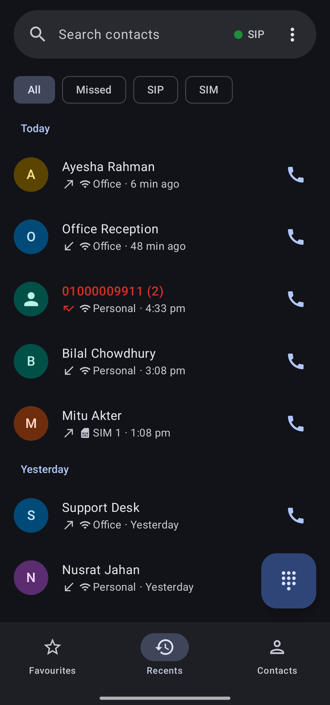 Recents with SIP and SIM calls</td>
    <td align="center">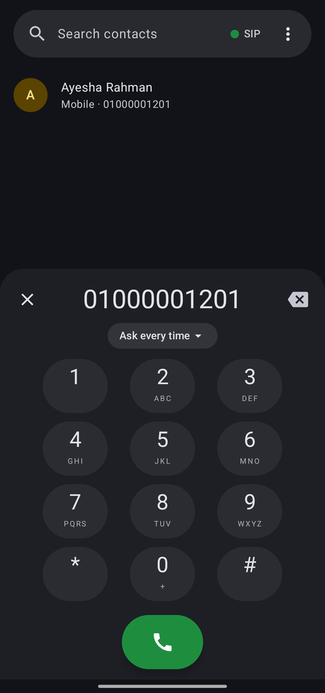 Keypad with contact search</td>
    <td align="center">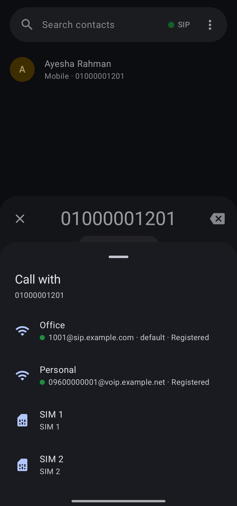 Pick a SIP account or SIM</td>
    <td align="center">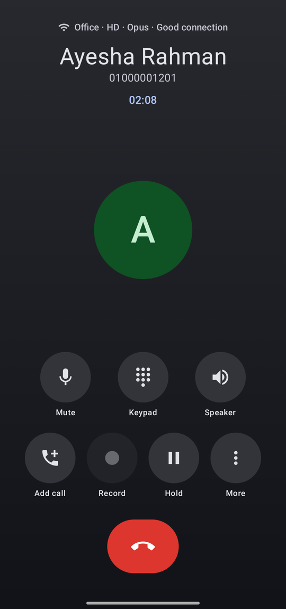 Call screen with HD voice</td>
  </tr>
  <tr>
    <td align="center">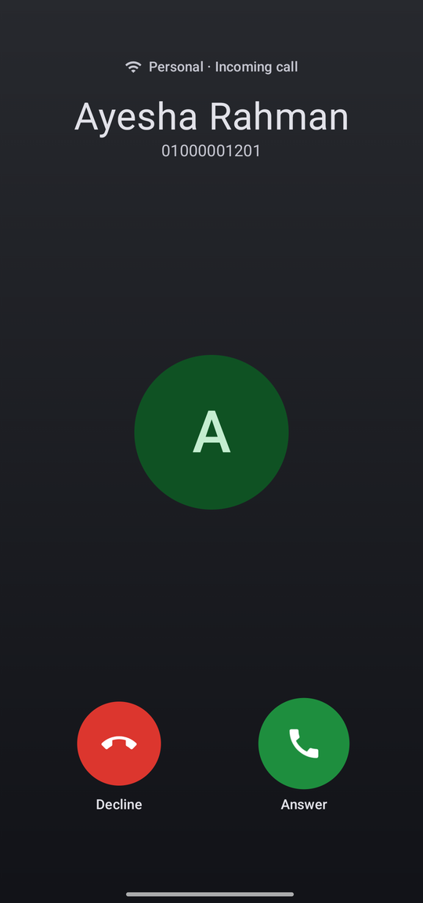 Incoming call</td>
    <td align="center">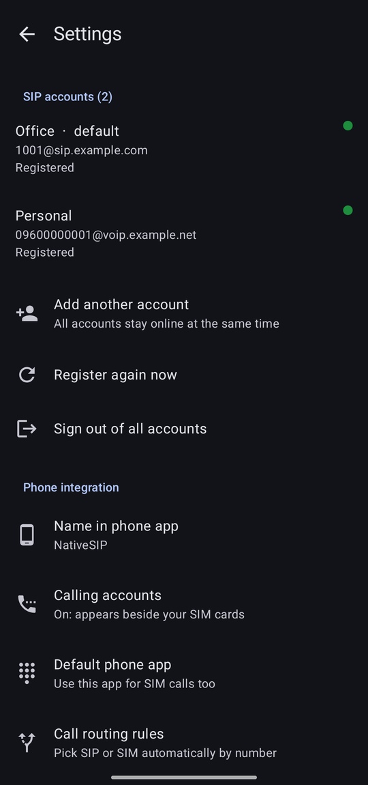 Several accounts online at once</td>
    <td align="center">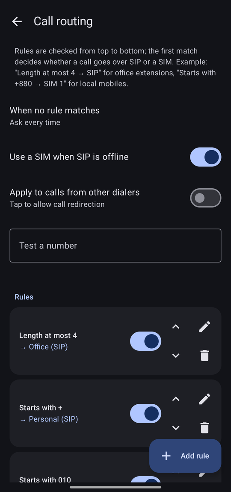 Automatic SIP/SIM routing</td>
    <td align="center">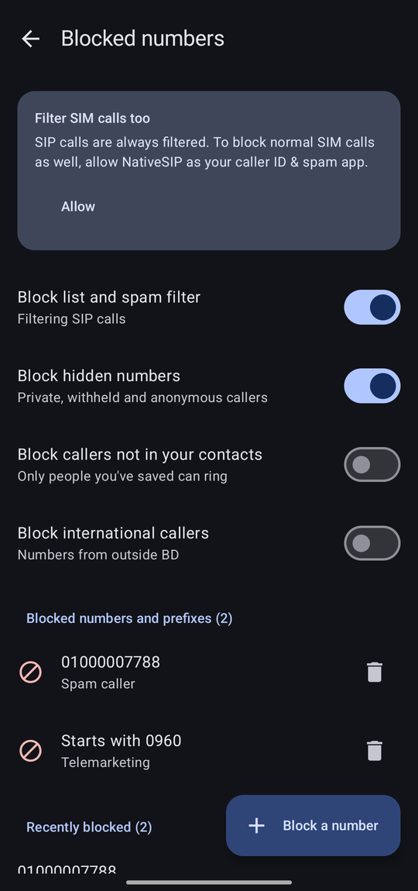 Block list and spam filter</td>
  </tr>
  <tr>
    <td align="center">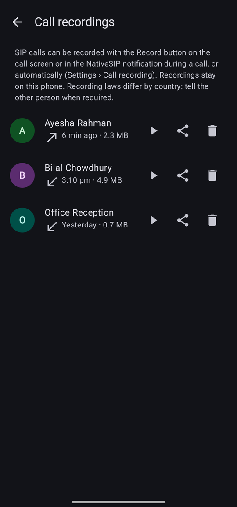 Call recordings</td>
    <td align="center">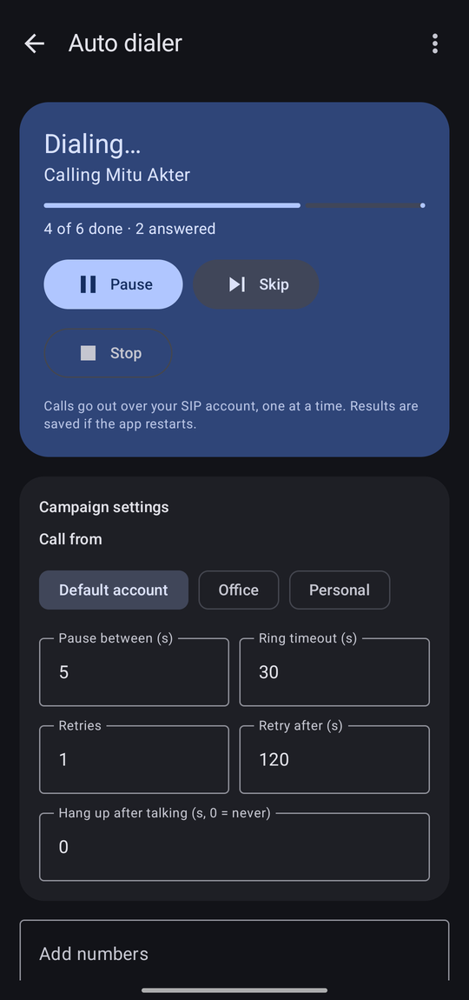 Auto dialer campaigns</td>
    <td align="center">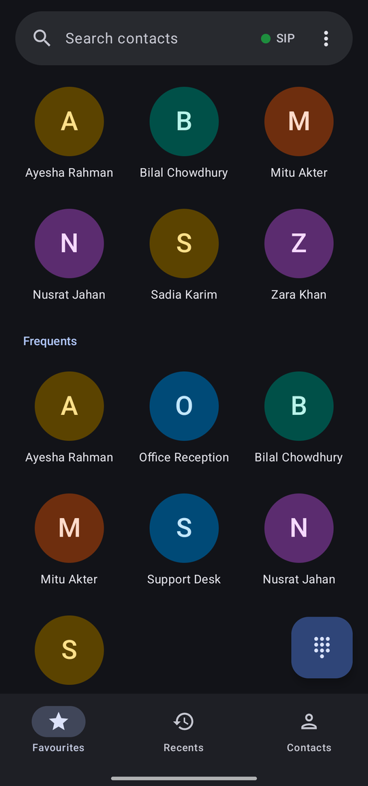 Favourites</td>
    <td align="center">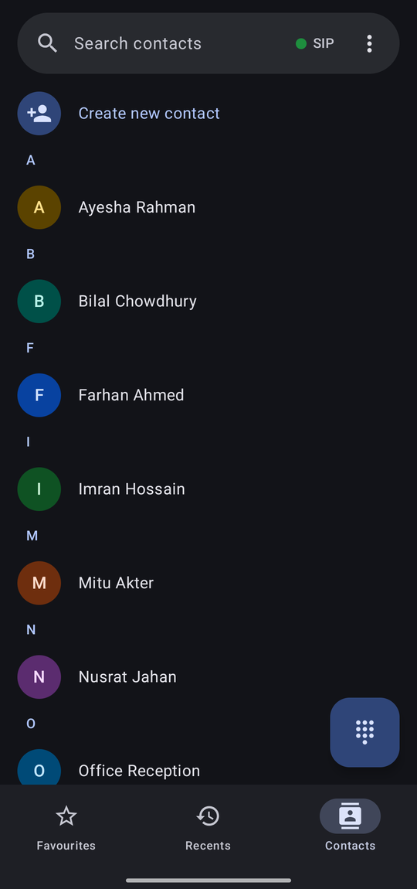 Contacts</td>
  </tr>
</table>

Screenshots use made-up names, numbers and accounts.

---

## Features

**Built into the phone**
- Appears beside your SIM cards in Google Phone and other dialers
- Incoming SIP calls use the phone's own call screen, ringtone and call history
- Always online: starts at boot, survives being swiped away, re-registers after network changes
- Optional: make NativeSIP your default phone app for SIM calls too

**Dialer**
- Clean Material You design: Favourites, Recents, Contacts, search
- Slide-up keypad with contact search (T9), editable number with cursor, paste, long-press 0 for +
- Full call screen: mute, speaker / Bluetooth / headset, hold, keypad (DTMF), add call, swap, transfer

**Accounts and routing**
- Several SIP accounts online at the same time, each with its own name in the dialer
- UDP, TCP or TLS, custom ports, outbound proxy, separate auth ID
- Routing rules: pick SIP or a specific SIM automatically by prefix, length or pattern, with number rewriting
- **Travel mode**: abroad, every call goes out on your home SIP number instead of a roaming SIM

**Call quality**
- HD voice where your provider supports it (Opus, G.722), plus G.711
- Echo cancellation, adaptive jitter buffer, adaptive bitrate, optional SRTP encryption
- Quality report after every call: packet loss, late packets, delay, and what to fix

**More**
- Call recording: automatic or on demand, stored privately on the phone
- Block list and spam filter for SIP and SIM calls
- Auto dialer: call a list of numbers one after another with retries and results

## Get started

1. [Install NativeSIP](docs/INSTALL.md): download the APK and install it.
2. Sign in with the SIP details from your VoIP provider or company PBX.
3. Follow the in-app setup checklist (permissions, Calling accounts, battery).

Then read the [User guide](docs/USER_GUIDE.md) for travel mode, recording, blocking and more.
Something not working? See [Troubleshooting](docs/TROUBLESHOOTING.md).

## Requirements

- Android 8.0 or newer
- A SIP account from a VoIP provider or PBX (NativeSIP doesn't provide phone numbers)
- Internet (Wi-Fi or mobile data) for calls

## Documentation

| Guide | What's in it |
| --- | --- |
| [Installation](docs/INSTALL.md) | Which APK to pick, installing, first-run setup, phone-maker battery settings |
| [User guide](docs/USER_GUIDE.md) | Every feature, step by step |
| [Troubleshooting](docs/TROUBLESHOOTING.md) | Registration, audio, missed calls, call quality |
| [Privacy](PRIVACY.md) | What the app stores and sends |
| [Changelog](CHANGELOG.md) | What changed in each release |

## Feedback

Found a bug or have an idea? [Open an issue](../../issues).

---

© MD. IEAHHIEA. NativeSIP's source code is not published in this repository; this repository holds
documentation and release builds only. Third-party components are listed in [NOTICE.md](NOTICE.md).
